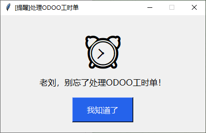

<div align="center">


# 💬 提醒弹窗管理工具

一个轻量级的 **Windows 桌面定时提醒工具**：可视化添加/编辑/删除提醒任务，到点自动弹出**置顶弹窗**，必须手动点击才能关闭——保证你不会错过打卡、日报、会议任何一件事。

[](https://github.com/vindy-lu/reminder-tool/releases)
[](LICENSE)
[](https://github.com/vindy-lu/reminder-tool)
[](https://github.com/vindy-lu/reminder-tool/stargazers)

</div>

---

## ✨ 功能特性

| 功能             | 说明                                                         |
| ---------------- | ------------------------------------------------------------ |
| 🖥️ **可视化界面** | 填参数即可添加/编辑/删除提醒任务，无需命令行                 |
| ⏰ **置顶弹窗**   | 到点弹出，置顶显示，**必须手动点按钮关闭**（防错过）         |
| 📅 **灵活定时**   | 每天 / 每周（可勾选任意星期组合）/ **一次性**（提醒一次后自动删除） |
| ✏️ **双击编辑**   | 双击任务行弹出编辑框，改完一键保存重建                       |
| 🧪 **实时预览**   | 添加前可"立即测试弹窗"预览效果                               |
| 🚫 **免安装**     | 独立 exe，无需安装 Python，双击即用                          |

## 📸 界面预览

**管理工具**


**提醒弹窗**



## 📥 下载使用

1. 前往 [Releases](https://github.com/vindy-lu/reminder-tool/releases) 下载最新版 `ReminderManager_vX.X.zip`
2. 解压到任意目录（⚠️ **两个 exe 必须放在同一目录**）
3. 双击 `ReminderManager.exe` 打开管理工具

> 💡 建议：右键 `ReminderManager.exe` → 发送到 → 桌面快捷方式，方便日常打开。

## 🚀 快速上手

1. 打开管理工具，在下半区填写：**任务名、弹窗标题、弹窗内容、按钮文字**
2. 选择**频率**（每天 / 每周 / 一次性）和**时间**（如 `17:00`）
3. 选"每周"时勾选需要的**星期几**；选"一次性"时填写**执行日期**（如 `2026-12-01`）
4. 点 **"▶️ 立即测试弹窗"** 预览效果
5. 满意后点 **"✅ 确定添加"**
6. 到点自动弹出提醒！✅

> 🕐 **一次性任务**用的是 Windows 计划任务的"运行一次 + 运行后删除"（`-SC ONCE -Z`），
> 弹完这一次窗口，任务会由系统自动删除，列表里也就不再有它，不用手动清理。

## ⚠️ 注意事项

- **仅支持 Windows 10/11**（依赖 Windows 任务计划程序 `schtasks`）
- 任务名**不支持 emoji**（Windows 计划任务编码限制），emoji 可放在弹窗标题/内容里
- 任务名里的 `: / \ * ? " < > |` 和 `..` 会被**自动换成全角字符**（这几个是 Windows 任务名的非法字符，直接提交会报"参数错误"）。例如 `10:30 提醒` 保存为 `10：30 提醒`
- 电脑需**开机且登录状态**才会触发（关机/休眠不触发）
- 首次添加任务若杀毒软件拦截，选择"允许"或将 exe 加入信任区

## 🔧 常见问题（FAQ）

**Q: 弹窗没出来？**
A: 确认电脑是开机登录状态；检查管理工具上半区任务列表里任务是否存在。

**Q: 360/杀毒软件拦截？**
A: 这是杀毒软件对"程序创建计划任务"的正常提示（木马也常这么做）。选择"允许"，或把 exe 所在目录加入杀毒软件信任区，一劳永逸。

**Q: 想改提醒内容？**
A: 双击任务行 → 编辑对话框直接改 → 确定保存。

**Q: 想删除提醒？**
A: 列表选中任务 → 点"🗑️ 删除选中任务"。

**Q: 一次性提醒弹完还留在列表里吗？**
A: 不会。一次性任务加的是 `schtasks -SC ONCE -Z`，弹完这一次后 Windows 自己把任务删掉。如果想提前取消，选中删除即可。

**Q: 为什么我输的 `10:30 提醒` 存成了 `10：30 提醒`？**
A: 任务名对应 Windows 任务计划里的文件名，`:` `..` 这类字符会被系统拒绝（就是那个"参数错误"）。工具会自动换成视觉相同的全角字符，并在保存前提示你改成了什么。

**Q: 换电脑/重装系统后任务还在吗？**
A: 任务存在 Windows 计划任务里，重装系统会丢失。重新添加即可（数据不涉及文件存储）。

## 🧑‍💻 开发与测试

纯逻辑（任务名清洗、时间/日期校验、触发器拼装、schtasks 输出解析）与 GUI 冒烟测试分开：

```bash
python -m unittest discover -s tests -v              # 24 项
xvfb-run -a python -m unittest discover -s tests     # 无图形环境时
```

Windows 上跑测试不需要管理员权限；`tests/test_gui_smoke.py` 会给 `schtasks` 打桩，不会真的创建任务。

## 💬 反馈与支持

使用中遇到任何问题（bug、功能建议、部署疑问），欢迎提交 [Issues](https://github.com/vindy-lu/reminder-tool/issues) 反馈，我会持续改进优化。如果项目对你有帮助，也欢迎点个 ⭐ Star 支持一下！

## 📄 开源协议

本项目基于 [MIT](LICENSE) 协议开源，欢迎使用、修改、分发。
