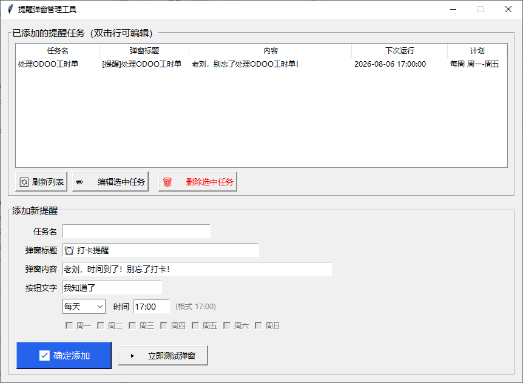

<div align="center">

# 💬 提醒弹窗管理工具

一个轻量级的 **Windows 桌面定时提醒工具**：可视化添加/编辑/删除提醒任务，到点自动弹出**置顶弹窗**，必须手动点击才能关闭——保证你不会错过打卡、日报、会议任何一件事。

[](https://github.com/vindy-lu/reminder-tool/releases)
[](LICENSE)
[](https://github.com/vindy-lu/reminder-tool)
[](https://github.com/vindy-lu/reminder-tool/stargazers)

</div>

---

## ✨ 功能特性

| 功能 | 说明 |
|------|------|
| 🖥️ **可视化界面** | 填参数即可添加/编辑/删除提醒任务，无需命令行 |
| ⏰ **置顶弹窗** | 到点弹出，置顶显示，**必须手动点按钮关闭**（防错过） |
| 📅 **灵活定时** | 支持每天 / 每周，可勾选周一到周日任意组合 |
| ✏️ **双击编辑** | 双击任务行弹出编辑框，改完一键保存重建 |
| 🧪 **实时预览** | 添加前可"立即测试弹窗"预览效果 |
| 🚫 **免安装** | 打包为独立 exe，无需安装 Python，双击即用 |

## 📸 界面预览

> 截图待补充。建议在仓库根目录添加以下两张图片，并替换下面的图片链接：
> - `screenshot_main.png` —— 管理工具主界面
> - `screenshot_popup.png` —— 提醒弹窗效果
>
> 添加后把下面两行的文件名替换为实际文件名即可：

| 管理工具 | 提醒弹窗 |
|---------|---------|
|  |  |

## 📥 下载使用

1. 前往 [Releases](https://github.com/vindy-lu/reminder-tool/releases) 下载最新版 `ReminderManager_vX.X.zip`
2. 解压到任意目录（⚠️ **两个 exe 必须放在同一目录**）
3. 双击 `ReminderManager.exe` 打开管理工具

> 💡 建议：右键 `ReminderManager.exe` → 发送到 → 桌面快捷方式，方便日常打开。

## 🚀 快速上手

1. 打开管理工具，在下半区填写：**任务名、弹窗标题、弹窗内容、按钮文字**
2. 选择**频率**（每天 / 每周）和**时间**（如 `17:00`）
3. 选"每周"时勾选需要的**星期几**
4. 点 **"▶️ 立即测试弹窗"** 预览效果
5. 满意后点 **"✅ 确定添加"**
6. 到点自动弹出提醒！✅

## ⚠️ 注意事项

- **仅支持 Windows 10/11**（依赖 Windows 任务计划程序 `schtasks`）
- 任务名**不支持 emoji**（Windows 计划任务编码限制），emoji 可放在弹窗标题/内容里
- 电脑需**开机且登录状态**才会触发（关机/休眠不触发）
- 首次添加任务若杀毒软件拦截，选择"允许"或将 exe 加入信任区

## 🔧 常见问题（FAQ）

**Q: 弹窗没出来？**
A: 确认电脑是开机登录状态；检查管理工具上半区任务列表里任务是否存在。

**Q: 360/杀毒软件拦截？**
A: 这是杀毒软件对"程序创建计划任务"的正常提示（木马也常这么做）。选择"允许"，或把 exe 所在目录加入杀毒软件信任区，一劳永逸。

**Q: 想改提醒内容？**
A: 双击任务行 → 编辑对话框直接改 → 确定保存。

**Q: 想删除提醒？**
A: 列表选中任务 → 点"🗑️ 删除选中任务"。

**Q: 换电脑/重装系统后任务还在吗？**
A: 任务存在 Windows 计划任务里，重装系统会丢失。重新添加即可（数据不涉及文件存储）。

## 🛠️ 从源码运行（开发者）

需要 Python 3.10+（仅用标准库，无第三方依赖）：

```bash
git clone https://github.com/vindy-lu/reminder-tool.git
cd reminder-tool
python reminder_manager.py
```

**打包为 exe**（需安装 PyInstaller）：

```bash
pip install pyinstaller
pyinstaller --noconfirm --onefile --windowed --name ReminderManager reminder_manager.py
pyinstaller --noconfirm --onefile --windowed --name ClockReminder clock_reminder.py
# 两个 exe 需放在同一目录使用
```

## 📁 项目结构

```
reminder-tool/
├── reminder_manager.py   # 可视化管理工具（主程序）
├── clock_reminder.py     # 弹窗脚本（被计划任务调用）
├── README.md
└── LICENSE               # MIT
```

## 🗺️ 路线图

- [x] 基础增删改查 + 定时弹窗
- [x] 打包独立 exe 发布
- [ ] 开机自启动设置
- [ ] 弹窗音效/提醒铃声
- [ ] 多语言支持

## 📄 开源协议

本项目基于 [MIT](LICENSE) 协议开源，欢迎使用、修改、分发。
